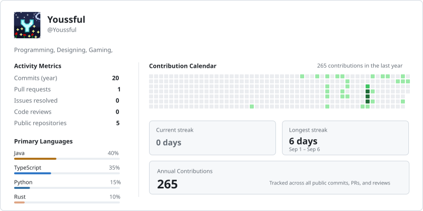

<!-- ╔══════════════════════════════════════════════════════════════╗ -->
<!-- ║                                                              ║ -->
<!-- ║                    ★  YOUSSFUL  ★                            ║ -->
<!-- ║          AI Engineer · Java · Python · Rust                  ║ -->
<!-- ║                                                              ║ -->
<!-- ╚══════════════════════════════════════════════════════════════╝ -->

<div align="center">

<!-- Readmint-rendered profile card: switches between light and dark automatically -->
<picture>
  <source media="(prefers-color-scheme: dark)" srcset="readmint/card-dark.svg">
  
</picture>

</div>

---

<div align="center">

```
 ██╗   ██╗ ██████╗ ██╗   ██╗███████╗███████╗███████╗██╗   ██╗ ██╗
 ╚██╗ ██╔╝██╔═══██╗██║   ██║██╔════╝██╔════╝██╔════╝██║   ██║ ██║
  ╚████╔╝ ██║   ██║██║   ██║███████╗███████╗█████╗  ██║   ██║ ██║
   ╚██╔╝  ██║   ██║██║   ██║╚════██║╚════██║██╔══╝  ██║   ██║ ██║
    ██║   ╚██████╔╝╚██████╔╝███████║███████║██║     ╚██████╔╝ ███████╗
    ╚═╝    ╚═════╝  ╚═════╝ ╚══════╝╚══════╝╚═╝      ╚═════╝  ╚══════╝
```

**AI Engineer** crafting intelligent systems & developer tools

[](https://github.com/Youssful)
[](https://github.com/Youssful)
[](https://github.com/Youssful)

</div>

---

### 🧠 About Me

> Building at the intersection of **AI/ML** and **systems programming** — from Minecraft server plugins to scalable backend services and machine learning pipelines.

- 🔭 Currently working on **AI-powered developer tools** & open-source plugins
- 🌱 Deep-diving into **LLM orchestration**, **Rust systems programming** & **distributed systems**
- ⚡ Background in **Minecraft plugin development** — shipped tools used across live servers
- 🤝 Open to collaborating on **AI tooling**, **backend infrastructure** & **open-source projects**

---

### 🛠️ Tech Stack

<div align="center">

| Domain | Technologies |
|--------|-------------|
| **Languages** | Java · Python · Rust · TypeScript · SQL |
| **AI / ML** | PyTorch · LangChain · Transformers · OpenAI API |
| **Backend** | Spring Boot · FastAPI · gRPC · REST |
| **Infra** | Docker · Kubernetes · GitHub Actions · Gradle |
| **Data** | PostgreSQL · Redis · Kafka · MongoDB |
| **Minecraft** | Paper API · Spigot · BungeeCord · Velocity |

</div>

---

### 📌 Featured Projects

<div align="center">

<a href="https://github.com/Youssful/MiniGame">
  
</a>
<a href="https://github.com/Youssful/DialogMenus">
  
</a>

<a href="https://github.com/Youssful/LagDetector">
  
</a>
<a href="https://github.com/Youssful/SeedProtector">
  
</a>

</div>

---

### 📊 Activity

<div align="center">


</div>

---

<div align="center">

<sub>⚡ Profile card rendered by <a href="https://github.com/MrLarkyy/Readmint">Readmint</a> — auto-updated daily via GitHub Actions</sub>

<br/>


</div>
